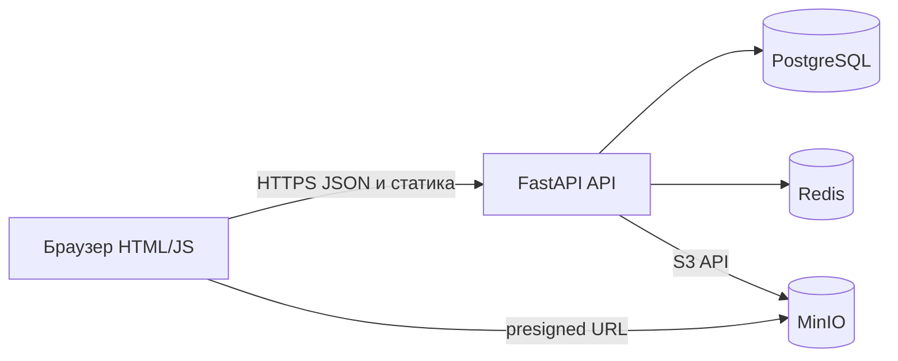

# Архитектура копии YouTube

Документ фиксирует целевую архитектуру сервиса по требованиям `AGENTS.md`: Python 3.11, FastAPI, PostgreSQL, MinIO (S3), Redis, простой фронтенд (HTML/JS), Docker Compose, роли `user` / `moderator` / `admin`, приватные видео и обязательный Swagger на `/docs`.

## Цели и ограничения

- Один процесс API обслуживает JSON и статику фронтенда. Отдельный фронтенд-контейнер не нужен.
- Видеофайлы и превью живут в MinIO. В PostgreSQL хранятся только ключи объектов и метаданные.
- Приватное видео отдаётся только владельцу, модераторам, администраторам и пользователям из списка доступа.
- Роли проверяются на каждом защищённом эндпоинте. Модератор разбирает жалобы и скрывает контент. Администратор управляет ролями и блокировками.
- OpenAPI генерируется FastAPI. UI документации доступен на `/docs`, схема — на `/openapi.json`.
- Код слоёв типизирован (`Type Hints`) и снабжён docstring на публичных функциях и классах.

## Логическая схема



Браузер не ходит в PostgreSQL и Redis. Загрузка и воспроизведение файла идут по временной ссылке MinIO, которую выдаёт API после проверки прав.

## Контейнеры Docker Compose

Сеть одна: `app`. Снаружи публикуются только API и, на время разработки, консоль MinIO. PostgreSQL и Redis остаются во внутренней сети.

| Сервис | Образ | Назначение | Порт на хосте | Тома |
| --- | --- | --- | --- | --- |
| `api` | Сборка из `Dockerfile` (Python 3.11) | FastAPI, Uvicorn, статика фронтенда | `8000` | код монтируется только в dev |
| `db` | `postgres:16` | Основное хранилище | не публикуется | `pg_data` |
| `minio` | `minio/minio` | Видео, превью, аватары | `9000` API, `9001` консоль | `minio_data` |
| `redis` | `redis:7-alpine` | Кэш, лимиты, дедуп просмотров, чёрный список токенов | не публикуется | без тома |

Зависимости `api`: `db` (healthy), `redis` (healthy), `minio` (healthy).

Одноразовый сервис `minio-init` (профиль `init` или `depends_on` с `restart: "no"`) создаёт бакет `media` и политику: объекты закрыты, чтение и запись только через API или presigned URL. Это вспомогательный контейнер, не отдельный runtime-компонент.

### `api`

- Команда: `uvicorn app.main:app --host 0.0.0.0 --port 8000`.
- Переменные: `DATABASE_URL`, `REDIS_URL`, `S3_ENDPOINT`, `S3_ACCESS_KEY`, `S3_SECRET_KEY`, `S3_BUCKET`, `JWT_SECRET`, `JWT_ACCESS_TTL`, `JWT_REFRESH_TTL`.
- Healthcheck: `GET /health` возвращает 200, если процесс жив. Готовность БД проверяется отдельно и не блокирует сам healthcheck процесса.
- В образ копируются `app/` и `frontend/`. В разработке каталоги монтируются с хоста, включён `--reload`.

### `db`

- Образ `postgres:16`, переменные `POSTGRES_USER`, `POSTGRES_PASSWORD`, `POSTGRES_DB=youtube`.
- Кодировка `UTF8`, локаль `C`.
- Healthcheck: `pg_isready -U $POSTGRES_USER -d $POSTGRES_DB`.
- Миграции применяет API при старте (Alembic), а не entrypoint Postgres.

### `minio`

- Команда: `server /data --console-address ":9001"`.
- Учётные данные только из переменных окружения, не из репозитория.
- Healthcheck: `GET /minio/health/ready`.
- Бакет `media`. Ключи объектов:
  - `videos/{video_id}/source`
  - `videos/{video_id}/thumbnail`
  - `avatars/{user_id}`

### `redis`

- Образ `redis:7-alpine`, без персистентности: потеря кэша не теряет данные пользователей.
- Назначение ключей:
  - `rl:{user_or_ip}:{route}` — скользящее окно лимита запросов.
  - `view:{video_id}:{user_or_ip}` — дедуп просмотра на короткое окно (например, 30 минут).
  - `jwt:deny:{jti}` — отозванные access/refresh до истечения TTL.
  - `feed:{user_id}` — короткий кэш ленты подписок.
- Healthcheck: `redis-cli ping`.

### Фрагмент compose

```yaml
services:
  api:
    build: .
    ports:
      - "8000:8000"
    env_file: .env
    depends_on:
      db:
        condition: service_healthy
      redis:
        condition: service_healthy
      minio:
        condition: service_healthy

  db:
    image: postgres:16
    environment:
      POSTGRES_USER: youtube
      POSTGRES_PASSWORD: ${POSTGRES_PASSWORD}
      POSTGRES_DB: youtube
    volumes:
      - pg_data:/var/lib/postgresql/data
    healthcheck:
      test: ["CMD-SHELL", "pg_isready -U youtube -d youtube"]
      interval: 5s
      timeout: 3s
      retries: 10

  minio:
    image: minio/minio
    command: server /data --console-address ":9001"
    ports:
      - "9000:9000"
      - "9001:9001"
    environment:
      MINIO_ROOT_USER: ${S3_ACCESS_KEY}
      MINIO_ROOT_PASSWORD: ${S3_SECRET_KEY}
    volumes:
      - minio_data:/data

  redis:
    image: redis:7-alpine
    healthcheck:
      test: ["CMD", "redis-cli", "ping"]
      interval: 5s
      timeout: 3s
      retries: 10

volumes:
  pg_data:
  minio_data:
```

Секреты лежат в `.env`, файл не коммитится. В репозитории остаётся `.env.example` без значений.

## Слои приложения

```text
frontend/          HTML, CSS, JS. Ходит только в /api и по presigned URL.
app/main.py        FastAPI, CORS, StaticFiles, подключение роутеров, /docs.
app/api/           Роутеры: auth, users, videos, comments, reactions, subscriptions, reports, admin.
app/services/      Сценарии: права на видео, загрузка, модерация, счётчики.
app/repositories/  Запросы SQLAlchemy 2.0. Без бизнес-правил.
app/models/        ORM-модели, совпадают со схемой в docs/DATABASE.md.
app/schemas/       Pydantic-модели запроса и ответа.
app/core/          настройки, безопасность JWT, клиенты Redis и S3, зависимости ролей.
alembic/           миграции PostgreSQL.
```

Роутер принимает схему, вызывает сервис и возвращает схему. Сервис решает, можно ли видеть приватное видео. Репозиторий не проверяет роли.

## Аутентификация и роли

- Регистрация и вход по email и паролю. Пароль хранится как хеш (Argon2 или bcrypt).
- Access JWT короткий (минуты), refresh длиннее (дни). В payload: `sub` (id пользователя), `role`, `jti`.
- Выход кладёт `jti` в Redis до `exp`.
- Зависимости FastAPI: `get_current_user`, `require_role("moderator")`, `require_role("admin")`.
- Роль в токене сверяется с `users.role` на операциях смены роли и блокировки, чтобы отозванная роль не жила до конца access TTL. Для остальных запросов достаточно claim и проверки `is_active`.

| Действие | user | moderator | admin |
| --- | --- | --- | --- |
| Свои видео, комментарии, лайки, подписки | да | да | да |
| Выдать доступ к своему приватному видео | да | да | да |
| Скрыть чужой комментарий или видео, закрыть жалобу | нет | да | да |
| Назначить роль, заблокировать аккаунт | нет | нет | да |

Заблокированный пользователь (`is_active = false`) не проходит `get_current_user`. Его публичные видео остаются в каталоге, пока модератор не сменит статус.

## Приватность видео

Поле `videos.visibility`:

- `public` — в ленте и поиске, смотрит любой, включая анонима.
- `unlisted` — нет в ленте и поиске, смотрит любой, у кого есть ссылка.
- `private` — нет в ленте и поиске. Смотрят владелец, модератор, администратор и строки из `video_access`.

Проверка собрана в одном сервисе `can_view_video`. Её вызывают выдача карточки, выдача presigned URL, список комментариев и постановка лайка. Прямая ссылка MinIO без подписи не работает: бакет закрыт.

Владелец добавляет и удаляет пользователей в `video_access` по id. Запись чужого доступа отклоняется.

## Основные сценарии

### Загрузка

1. Клиент создаёт запись видео (`processing`) и получает id.
2. API выдаёт presigned `PUT` на `videos/{id}/source` и, отдельно, на превью.
3. Клиент загружает файл в MinIO.
4. Клиент подтверждает загрузку. API проверяет, что объект существует (`HeadObject`), ставит `ready` и `published_at`.
5. Пока статус не `ready` или равен `blocked` / `failed`, ссылка на просмотр не выдаётся.

Отдельного воркера транскодинга в первой версии нет. Статус `processing` зарезервирован на время загрузки.

### Просмотр

1. API проверяет видимость и доступ.
2. Для нового зрителя в окне дедупа Redis увеличивает `videos.views_count` и ставит ключ `view:{video_id}:{viewer}`.
3. API возвращает метаданные и presigned `GET` с коротким TTL.

### Лента

Лента подписок читает `subscriptions` и публичные `ready`-видео этих каналов. Результат первой страницы кэшируется в Redis на десятки секунд. Приватные и unlisted в ленту не попадают.

### Жалоба и модерация

Пользователь создаёт `reports` со статусом `open`. Модератор переводит жалобу в `reviewing`, затем в `resolved` или `rejected`, пишет `resolution_note` и при необходимости ставит видео `blocked` или помечает комментарий `is_hidden`. Скрытый комментарий не отдаётся обычным пользователям. Автор и модератор его видят.

## Контракт API

Префикс `/api`. Группы тегов в OpenAPI: `auth`, `users`, `videos`, `comments`, `reactions`, `subscriptions`, `reports`, `moderation`.

Обязательные точки входа документации:

- `GET /docs` — Swagger UI.
- `GET /openapi.json` — схема.
- `GET /health` — живость процесса.

Ошибки — JSON `{ "detail": "..." }` со стандартными кодами FastAPI: 400, 401, 403, 404, 409, 422, 429.

Фронтенд — статические файлы с `/`. Он хранит access token в памяти страницы и refresh в `httpOnly` не использует: простой JS-клиент держит оба токена в `sessionStorage` и обновляет access через `POST /api/auth/refresh`. Это осознанное упрощение учебного фронтенда.

## Что сознательно не входит в первую версию

- Транскодинг и несколько качеств.
- Полнотекстовый поиск отдельным движком. Поиск по `ILIKE` по названию достаточен, пока каталог маленький.
- WebSocket-уведомления. Факт подписки хранится, доставка событий не реализуется.
- Отдельные контейнеры фронтенда и воркера очередей.
