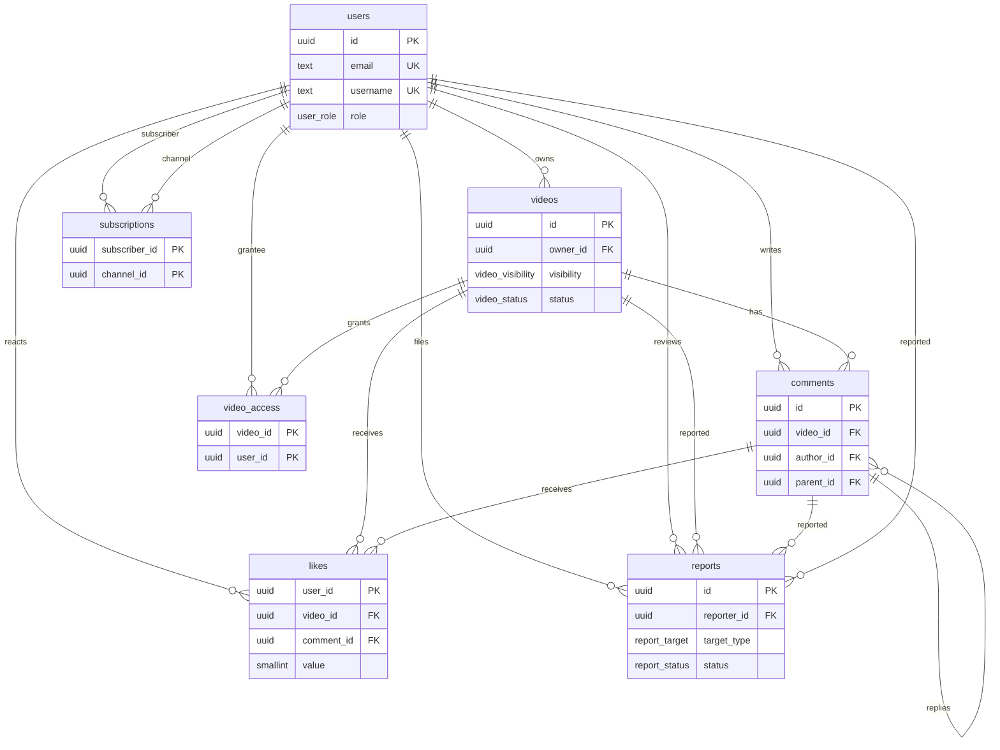

# Схема PostgreSQL

База `youtube`, кодировка `UTF8`. Идентификаторы — `UUID`, время — `TIMESTAMPTZ` в UTC. Имена в `snake_case`. Внешние ключи с явным `ON DELETE`.

Схема покрывает таблицы из постановки (`users`, `videos`, `comments`, `likes`, `subscriptions`, `reports`) и одну служебную таблицу `video_access`. Она нужна, потому что приватное видео должно быть видно только тем, кому доступ выдал владелец. Хранить этот список массивом в `videos` нельзя: не будет нормального уникального ограничения и индекса по зрителю.

Миграции ведёт Alembic. ORM-модели в `app/models` совпадают с этой схемой.

## Перечисления

```sql
CREATE TYPE user_role AS ENUM ('user', 'moderator', 'admin');

CREATE TYPE video_visibility AS ENUM ('public', 'unlisted', 'private');

CREATE TYPE video_status AS ENUM ('processing', 'ready', 'failed', 'blocked');

CREATE TYPE report_target AS ENUM ('video', 'comment', 'user');

CREATE TYPE report_reason AS ENUM (
    'spam',
    'harassment',
    'hate',
    'violence',
    'sexual_content',
    'copyright',
    'other'
);

CREATE TYPE report_status AS ENUM ('open', 'reviewing', 'resolved', 'rejected');
```

## Связи



Правила удаления:

- Удаление пользователя удаляет его видео, комментарии, лайки, подписки, выданные ему доступы и его жалобы.
- Удаление видео удаляет его комментарии, лайки, доступы. Жалобы на видео остаются с `video_id = NULL` (`ON DELETE SET NULL`), чтобы модератор видел историю.
- Удаление комментария удаляет ответы через `parent_id` каскадом и лайки этого комментария.

На практике аккаунты не удаляют физически: администратор ставит `users.is_active = false`. Каскады нужны для явного удаления в админском сценарии и в тестах.

## `users`

Учётная запись и канал — одна сущность. Подписка ведёт на `users.id`.

| Поле | Тип | Ограничения |
| --- | --- | --- |
| `id` | `UUID` | PK, `gen_random_uuid()` |
| `email` | `CITEXT` | NOT NULL, UNIQUE |
| `username` | `CITEXT` | NOT NULL, UNIQUE, `^[a-z0-9_]{3,30}$` после приведения регистра |
| `password_hash` | `TEXT` | NOT NULL |
| `display_name` | `VARCHAR(80)` | NOT NULL |
| `bio` | `VARCHAR(1000)` | NOT NULL, по умолчанию `''` |
| `avatar_key` | `TEXT` | NULL, ключ объекта в MinIO |
| `role` | `user_role` | NOT NULL, по умолчанию `user` |
| `is_active` | `BOOLEAN` | NOT NULL, по умолчанию `TRUE` |
| `created_at` | `TIMESTAMPTZ` | NOT NULL, по умолчанию `now()` |
| `updated_at` | `TIMESTAMPTZ` | NOT NULL, по умолчанию `now()` |

`CITEXT` требует расширение `citext`. Так email и username уникальны без учёта регистра.

Индексы: уникальные по `email` и `username` создаются ограничениями. Дополнительно индекс не нужен.

`updated_at` обновляет триггер `set_updated_at()` (тот же триггер на `videos` и `comments`).

## `videos`

| Поле | Тип | Ограничения |
| --- | --- | --- |
| `id` | `UUID` | PK, `gen_random_uuid()` |
| `owner_id` | `UUID` | NOT NULL, FK → `users.id` ON DELETE CASCADE |
| `title` | `VARCHAR(120)` | NOT NULL |
| `description` | `VARCHAR(5000)` | NOT NULL, по умолчанию `''` |
| `visibility` | `video_visibility` | NOT NULL, по умолчанию `private` |
| `status` | `video_status` | NOT NULL, по умолчанию `processing` |
| `object_key` | `TEXT` | NULL до подтверждения загрузки, затем NOT NULL по смыслу сервиса |
| `thumbnail_key` | `TEXT` | NULL |
| `duration_seconds` | `INTEGER` | NULL, `CHECK (duration_seconds IS NULL OR duration_seconds >= 0)` |
| `views_count` | `BIGINT` | NOT NULL, по умолчанию `0`, `CHECK (views_count >= 0)` |
| `likes_count` | `INTEGER` | NOT NULL, по умолчанию `0`, `CHECK (likes_count >= 0)` |
| `dislikes_count` | `INTEGER` | NOT NULL, по умолчанию `0`, `CHECK (dislikes_count >= 0)` |
| `comments_count` | `INTEGER` | NOT NULL, по умолчанию `0`, `CHECK (comments_count >= 0)` |
| `created_at` | `TIMESTAMPTZ` | NOT NULL, по умолчанию `now()` |
| `updated_at` | `TIMESTAMPTZ` | NOT NULL, по умолчанию `now()` |
| `published_at` | `TIMESTAMPTZ` | NULL, заполняется при переходе в `ready` |

Новое видео создаётся как `private` + `processing`, чтобы недозаписанный объект не стал публичным.

Счётчики денормализованы. Лайки и комментарии меняют их в той же транзакции, что и строку `likes` или `comments`. Просмотры увеличивает API после дедупа в Redis. Лента и карточка не считают агрегаты на лету.

Индексы:

- `videos_owner_created_idx` на `(owner_id, created_at DESC)` — канал автора.
- `videos_public_feed_idx` на `(published_at DESC)` где `visibility = 'public' AND status = 'ready'` — общая лента.
- `videos_title_trgm_idx` — `GIN (title gin_trgm_ops)` при включённом `pg_trgm`, для поиска. Пока каталог маленький, допустим `ILIKE` без этого индекса; индекс добавляется миграцией, когда поиск станет медленным.

## `video_access`

Кто может смотреть конкретное приватное видео помимо владельца и персонала.

| Поле | Тип | Ограничения |
| --- | --- | --- |
| `video_id` | `UUID` | PK, FK → `videos.id` ON DELETE CASCADE |
| `user_id` | `UUID` | PK, FK → `users.id` ON DELETE CASCADE |
| `granted_by` | `UUID` | NOT NULL, FK → `users.id` ON DELETE CASCADE |
| `created_at` | `TIMESTAMPTZ` | NOT NULL, по умолчанию `now()` |

Первичный ключ `(video_id, user_id)` не даёт выдать доступ дважды. Индекс по `user_id` нужен для выборки «видео, которыми со мной поделились»: `video_access_user_idx` на `(user_id)`.

Сервис записывает строку только если `granted_by` — владелец видео или администратор. Строка не заменяет роль: модератор видит приватное видео без записи в этой таблице.

Для `public` и `unlisted` таблица не читается.

## `comments`

Дерево из одного уровня ответов. Корень: `parent_id IS NULL`. Ответ ссылается на корневой комментарий того же видео. Ответ на ответ в первой версии приводится к корню на стороне сервиса, чтобы не плодить глубину.

| Поле | Тип | Ограничения |
| --- | --- | --- |
| `id` | `UUID` | PK, `gen_random_uuid()` |
| `video_id` | `UUID` | NOT NULL, FK → `videos.id` ON DELETE CASCADE |
| `author_id` | `UUID` | NOT NULL, FK → `users.id` ON DELETE CASCADE |
| `parent_id` | `UUID` | NULL, FK → `comments.id` ON DELETE CASCADE |
| `body` | `VARCHAR(2000)` | NOT NULL, `CHECK (char_length(btrim(body)) > 0)` |
| `is_hidden` | `BOOLEAN` | NOT NULL, по умолчанию `FALSE` |
| `created_at` | `TIMESTAMPTZ` | NOT NULL, по умолчанию `now()` |
| `updated_at` | `TIMESTAMPTZ` | NOT NULL, по умолчанию `now()` |

Индексы:

- `comments_video_created_idx` на `(video_id, created_at)` где `parent_id IS NULL AND is_hidden = FALSE` — лента комментариев под видео.
- `comments_parent_idx` на `(parent_id, created_at)` где `parent_id IS NOT NULL` — ответы.

Проверка «родитель принадлежит тому же `video_id`» делается в сервисе перед вставкой. Составной внешний ключ потребовал бы уникальность `(id, video_id)` и усложнил бы каскад без выигрыша на этом объёме.

`comments_count` на видео считает видимые корни и ответы. При `is_hidden = TRUE` счётчик уменьшается.

## `likes`

Одна таблица на реакции к видео и к комментариям. Ровно одна цель: либо `video_id`, либо `comment_id`.

| Поле | Тип | Ограничения |
| --- | --- | --- |
| `user_id` | `UUID` | NOT NULL, FK → `users.id` ON DELETE CASCADE |
| `video_id` | `UUID` | NULL, FK → `videos.id` ON DELETE CASCADE |
| `comment_id` | `UUID` | NULL, FK → `comments.id` ON DELETE CASCADE |
| `value` | `SMALLINT` | NOT NULL, `CHECK (value IN (1, -1))` |
| `created_at` | `TIMESTAMPTZ` | NOT NULL, по умолчанию `now()` |
| `updated_at` | `TIMESTAMPTZ` | NOT NULL, по умолчанию `now()` |

Ограничения:

```sql
ALTER TABLE likes
    ADD CONSTRAINT likes_one_target CHECK (
        (video_id IS NOT NULL AND comment_id IS NULL)
        OR (video_id IS NULL AND comment_id IS NOT NULL)
    );

ALTER TABLE likes
    ADD CONSTRAINT likes_comment_positive CHECK (
        comment_id IS NULL OR value = 1
    );

CREATE UNIQUE INDEX likes_user_video_uidx
    ON likes (user_id, video_id)
    WHERE video_id IS NOT NULL;

CREATE UNIQUE INDEX likes_user_comment_uidx
    ON likes (user_id, comment_id)
    WHERE comment_id IS NOT NULL;
```

`value = 1` — лайк, `value = -1` — дизлайк видео. У комментария только лайк.

Смена реакции — `UPDATE` той же строки и поправка `likes_count` / `dislikes_count` на видео. Повтор того же значения удаляет строку (снятие реакции) и уменьшает счётчик. Удаление и вставка в одной транзакции.

Отдельного суррогатного `id` нет: уникальность задаёт пара пользователь + цель.

## `subscriptions`

| Поле | Тип | Ограничения |
| --- | --- | --- |
| `subscriber_id` | `UUID` | PK, FK → `users.id` ON DELETE CASCADE |
| `channel_id` | `UUID` | PK, FK → `users.id` ON DELETE CASCADE |
| `created_at` | `TIMESTAMPTZ` | NOT NULL, по умолчанию `now()` |

```sql
ALTER TABLE subscriptions
    ADD CONSTRAINT subscriptions_not_self CHECK (subscriber_id <> channel_id);

CREATE INDEX subscriptions_channel_idx
    ON subscriptions (channel_id, created_at DESC);
```

Первичный ключ `(subscriber_id, channel_id)` обслуживает проверку «я уже подписан» и список каналов пользователя. Индекс по `channel_id` обслуживает счётчик подписчиков и ленту «кто подписан».

Число подписчиков считается запросом `COUNT(*)`. Отдельный счётчик на `users` не хранится, пока нет экрана с массовым выводом этого числа в ленте.

## `reports`

Жалоба на видео, комментарий или пользователя. Ровно одна цель заполнена, тип цели совпадает с заполненным полем.

| Поле | Тип | Ограничения |
| --- | --- | --- |
| `id` | `UUID` | PK, `gen_random_uuid()` |
| `reporter_id` | `UUID` | NOT NULL, FK → `users.id` ON DELETE CASCADE |
| `target_type` | `report_target` | NOT NULL |
| `video_id` | `UUID` | NULL, FK → `videos.id` ON DELETE SET NULL |
| `comment_id` | `UUID` | NULL, FK → `comments.id` ON DELETE SET NULL |
| `target_user_id` | `UUID` | NULL, FK → `users.id` ON DELETE SET NULL |
| `reason` | `report_reason` | NOT NULL |
| `details` | `VARCHAR(2000)` | NOT NULL, по умолчанию `''` |
| `status` | `report_status` | NOT NULL, по умолчанию `open` |
| `moderator_id` | `UUID` | NULL, FK → `users.id` ON DELETE SET NULL |
| `resolution_note` | `VARCHAR(2000)` | NOT NULL, по умолчанию `''` |
| `created_at` | `TIMESTAMPTZ` | NOT NULL, по умолчанию `now()` |
| `resolved_at` | `TIMESTAMPTZ` | NULL |

```sql
ALTER TABLE reports
    ADD CONSTRAINT reports_target_shape CHECK (
        (
            target_type = 'video'
            AND video_id IS NOT NULL
            AND comment_id IS NULL
            AND target_user_id IS NULL
        )
        OR (
            target_type = 'comment'
            AND comment_id IS NOT NULL
            AND video_id IS NULL
            AND target_user_id IS NULL
        )
        OR (
            target_type = 'user'
            AND target_user_id IS NOT NULL
            AND video_id IS NULL
            AND comment_id IS NULL
        )
    );

ALTER TABLE reports
    ADD CONSTRAINT reports_not_self CHECK (
        target_user_id IS NULL OR target_user_id <> reporter_id
    );
```

Индексы:

- `reports_status_created_idx` на `(status, created_at)` — очередь модератора.
- `reports_reporter_idx` на `(reporter_id, created_at DESC)`.
- Частичные уникальные индексы, чтобы один пользователь не открывал вторую активную жалобу на ту же цель:

```sql
CREATE UNIQUE INDEX reports_open_video_uidx
    ON reports (reporter_id, video_id)
    WHERE video_id IS NOT NULL AND status IN ('open', 'reviewing');

CREATE UNIQUE INDEX reports_open_comment_uidx
    ON reports (reporter_id, comment_id)
    WHERE comment_id IS NOT NULL AND status IN ('open', 'reviewing');

CREATE UNIQUE INDEX reports_open_user_uidx
    ON reports (reporter_id, target_user_id)
    WHERE target_user_id IS NOT NULL AND status IN ('open', 'reviewing');
```

Закрытая жалоба (`resolved`, `rejected`) не блокирует новую. `moderator_id` и `resolved_at` заполняются при выходе из `open`. Сервис проверяет, что `moderator_id` имеет роль `moderator` или `admin`.

## Кто видит строку видео

Это правило сервиса, не row level security. В запросы списка оно попадает явным `WHERE`.

Видео отдаётся зрителю, если `status = 'ready'` и выполнено одно из условий:

- `visibility = 'public'`;
- `visibility = 'unlisted'` и запрос по id;
- зритель — `owner_id`;
- роль зрителя — `moderator` или `admin`;
- `visibility = 'private'` и есть строка `video_access` с этим `user_id`.

`blocked` и `failed` видит только владелец и персонал. Аноним (`viewer` отсутствует) проходит только первую ветку и unlisted по прямой ссылке.

Лента и поиск добавляют фильтр `visibility = 'public' AND status = 'ready'`.

## Расширения

```sql
CREATE EXTENSION IF NOT EXISTS pgcrypto;  -- gen_random_uuid на старых сборках; на PostgreSQL 16 достаточно встроенного
CREATE EXTENSION IF NOT EXISTS citext;
```

`pg_trgm` включается отдельной миграцией вместе с индексом поиска, не в начальной схеме.
