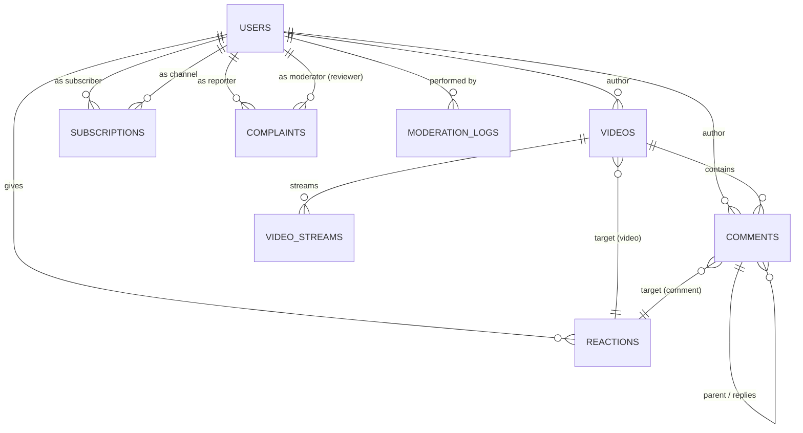

# Схема базы данных (PostgreSQL + async SQLAlchemy)

Все первичные ключи — `UUID` (генерируются приложением, `uuid4`).  
Временные метки — `TIMESTAMPTZ` со значением по умолчанию `now()`.  
Мягкое удаление не используется для видео/комментариев — вместо этого флаги `status` / `is_deleted` / `is_blocked`.

## Mermaid ERD

## 1. Таблица `users` — пользователи

| Поле | Тип | Ограничения | Описание |
|------|-----|-------------|----------|
| `id` | `UUID` | PK, default `uuid4` | Идентификатор |
| `email` | `VARCHAR(255)` | UK, NOT NULL, индекс | Электронная почта (логин) |
| `username` | `VARCHAR(50)` | UK, NOT NULL, индекс | Отображаемое имя |
| `password_hash` | `VARCHAR(255)` | NOT NULL | Хеш пароля bcrypt |
| `role` | `ENUM(user, moderator, admin)` | DEFAULT `user`, NOT NULL | Роль |
| `is_active` | `BOOLEAN` | DEFAULT `true` | Активен ли аккаунт |
| `is_verified` | `BOOLEAN` | DEFAULT `false` | Подтверждена ли почта |
| `avatar_url` | `VARCHAR(500)` | NULL | Ссылка на аватар в S3 |
| `bio` | `TEXT` | NULL | Описание канала |
| `created_at` | `TIMESTAMPTZ` | DEFAULT `now()` | Дата регистрации |
| `updated_at` | `TIMESTAMPTZ` | auto | Дата последнего изменения |
| `last_login_at` | `TIMESTAMPTZ` | NULL | Последний вход |

## 2. Таблица `videos` — видео

| Поле | Тип | Ограничения | Описание |
|------|-----|-------------|----------|
| `id` | `UUID` | PK, default `uuid4` | Идентификатор |
| `author_id` | `UUID` | FK → `users.id` ON DELETE CASCADE, индекс | Автор видео |
| `title` | `VARCHAR(200)` | NOT NULL | Название |
| `description` | `TEXT` | NULL | Описание |
| `original_s3_key` | `VARCHAR(500)` | NOT NULL | Ключ исходного файла в S3 |
| `thumbnail_s3_key` | `VARCHAR(500)` | NULL | Ключ превью в S3 |
| `duration_seconds` | `INTEGER` | NULL | Длительность |
| `views_count` | `INTEGER` | DEFAULT `0` | Количество просмотров |
| `status` | `ENUM(draft, processing, ready, rejected, deleted)` | DEFAULT `draft`, индекс | Статус модерации/обработки |
| `visibility` | `ENUM(public, unlisted, private)` | DEFAULT `public` | Видимость |
| `created_at` | `TIMESTAMPTZ` | DEFAULT `now()` | Загрузка |
| `updated_at` | `TIMESTAMPTZ` | auto | Изменение |
| `published_at` | `TIMESTAMPTZ` | NULL | Опубликовано |

Связь: `users` 1:N `videos` (автор).

## 3. Таблица `video_streams` — транскодированные потоки видео

| Поле | Тип | Ограничения | Описание |
|------|-----|-------------|----------|
| `id` | `UUID` | PK | Идентификатор |
| `video_id` | `UUID` | FK → `videos.id` ON DELETE CASCADE, индекс | Видео |
| `resolution` | `VARCHAR(10)` | NOT NULL | 360p / 720p / 1080p и т.д. |
| `s3_key` | `VARCHAR(500)` | NOT NULL | Ключ файла потока в S3 |
| `file_size` | `BIGINT` | NULL | Размер в байтах |
| `bitrate` | `INTEGER` | NULL | Битрейт (kbps) |
| `created_at` | `TIMESTAMPTZ` | DEFAULT `now()` | Дата создания |

Связь: `videos` 1:N `video_streams`.
## 4. Таблица `comments` — комментарии

| Поле | Тип | Ограничения | Описание |
|------|-----|-------------|----------|
| `id` | `UUID` | PK | Идентификатор |
| `video_id` | `UUID` | FK → `videos.id` ON DELETE CASCADE, индекс | Видео |
| `author_id` | `UUID` | FK → `users.id` ON DELETE CASCADE, индекс | Автор |
| `parent_id` | `UUID` | FK → `comments.id` ON DELETE CASCADE, NULL, индекс | Родительский комментарий (ответ) |
| `content` | `TEXT` | NOT NULL | Текст комментария |
| `is_deleted` | `BOOLEAN` | DEFAULT `false` | Удалён автором |
| `is_blocked` | `BOOLEAN` | DEFAULT `false` | Заблокирован модератором |
| `created_at` | `TIMESTAMPTZ` | DEFAULT `now()` | Создан |
| `updated_at` | `TIMESTAMPTZ` | auto | Отредактирован |

Связи: `videos` 1:N `comments`; `users` 1:N `comments`; `comments` 1:N `comments` (самореференция, ответы).

## 5. Таблица `reactions` — лайки / дизлайки

Единая таблица для реакций на видео и комментарии (полиморфная связь через `target_type` + `target_id`).

| Поле | Тип | Ограничения | Описание |
|------|-----|-------------|----------|
| `id` | `UUID` | PK | Идентификатор |
| `user_id` | `UUID` | FK → `users.id` ON DELETE CASCADE, индекс | Кто поставил |
| `target_type` | `ENUM(video, comment)` | NOT NULL | Целевой объект |
| `target_id` | `UUID` | NOT NULL, индекс | ID цели (видео или комментария) |
| `type` | `ENUM(like, dislike)` | NOT NULL | Тип реакции |
| `created_at` | `TIMESTAMPTZ` | DEFAULT `now()` | Дата |

Ограничения:
- `UNIQUE(user_id, target_type, target_id)` — одна реакция пользователя на одну цель.
- Проверка на уровне приложения: пользователь не может лайкать/дизлайкать свой контент.

## 6. Таблица `subscriptions` — подписки

| Поле | Тип | Ограничения | Описание |
|------|-----|-------------|----------|
| `id` | `UUID` | PK | Идентификатор |
| `subscriber_id` | `UUID` | FK → `users.id` ON DELETE CASCADE, индекс | Кто подписался |
| `channel_id` | `UUID` | FK → `users.id` ON DELETE CASCADE, индекс | На кого подписался (канал) |
| `created_at` | `TIMESTAMPTZ` | DEFAULT `now()` | Дата подписки |
| `is_active` | `BOOLEAN` | DEFAULT `true` | Активна ли подписка |

Ограничения:
- `UNIQUE(subscriber_id, channel_id)` — не более одной подписки.
- `CHECK subscriber_id <> channel_id` — нельзя подписаться на самого себя.

## 7. Таблица `complaints` — жалобы (модерация)

| Поле | Тип | Ограничения | Описание |
|------|-----|-------------|----------|
| `id` | `UUID` | PK | Идентификатор |
| `reporter_id` | `UUID` | FK → `users.id` ON DELETE CASCADE, индекс | Кто пожаловался |
| `target_type` | `ENUM(video, comment, user)` | NOT NULL | Объект жалобы |
| `target_id` | `UUID` | NOT NULL, индекс | ID объекта |
| `reason` | `ENUM(spam, violence, hate_speech, copyright, misinformation, other)` | NOT NULL | Причина |
| `description` | `TEXT` | NULL | Комментарий жалобщика |
| `status` | `ENUM(pending, reviewed, resolved, rejected)` | DEFAULT `pending`, индекс | Статус рассмотрения |
| `moderator_id` | `UUID` | FK → `users.id`, NULL | Модератор, который рассмотрел |
| `reviewed_at` | `TIMESTAMPTZ` | NULL | Дата рассмотрения |
| `created_at` | `TIMESTAMPTZ` | DEFAULT `now()` | Дата подачи |

Связи: `users` 1:N `complaints` (как `reporter`); `users` 1:N `complaints` (как `moderator`).

## 8. Таблица `moderation_logs` — аудит действий модераторов

| Поле | Тип | Ограничения | Описание |
|------|-----|-------------|----------|
| `id` | `UUID` | PK | Идентификатор |
| `moderator_id` | `UUID` | FK → `users.id` | Кто совершил действие |
| `action_type` | `ENUM(video_approved, video_rejected, comment_blocked, user_banned, complaint_resolved, complaint_rejected)` | NOT NULL | Тип действия |
| `target_type` | `VARCHAR(20)` | NOT NULL | video / comment / user / complaint |
| `target_id` | `UUID` | NOT NULL | ID объекта |
| `reason` | `TEXT` | NULL | Комментарий к действию |
| `created_at` | `TIMESTAMPTZ` | DEFAULT `now()` | Дата |

## Итоговые связи (сводка)

1. `users` → `videos` — 1:N (автор видео)
2. `users` → `comments` — 1:N (автор комментария)
3. `comments` → `comments` — 1:N (ответы через `parent_id`)
4. `videos` → `comments` — 1:N
5. `videos` → `video_streams` — 1:N (разрешения транскодирования)
6. `users` → `reactions` — 1:N (кто ставит реакции)
7. `reactions` → `videos` / `comments` — N:1 (полиморфная цель)
8. `users` → `subscriptions` — 1:N (как подписчик) и 1:N (как канал)
9. `users` → `complaints` — 1:N (пожаловался) и 1:N (модератор рассмотрел)
10. `users` → `moderation_logs` — 1:N (кто совершил действие модерации)

Хранение файлов: все медиафайлы (видео, превью, аватары) лежат в S3-хранилище; в БД хранятся только ключи (`s3_key`) и метаданные.